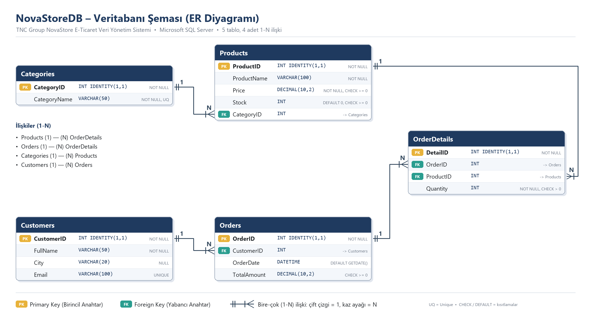

# NovaStore – E-Ticaret Veri Yönetim Sistemi

TNC Group / Software Persona **SQL eğitimi bitirme projesi**.
Kurgusal e-ticaret şirketi NovaStore için Microsoft SQL Server üzerinde tasarlanmış ilişkisel bir veritabanı (`NovaStoreDB`).

**Hazırlayan:** Talha Semih Pertev

## Projenin Amacı

Ürün, kategori, müşteri ve sipariş verilerini tutarlı biçimde saklayan bir veritabanı kurmak ve eğitimde işlenen konuları tek bir uygulamada göstermek:

- **DDL:** Veritabanı ve tabloların oluşturulması, birincil/yabancı anahtarlar ve veri bütünlüğü kısıtlamaları
- **DML:** Birbiriyle ilişkili, gerçekçi örnek veriler
- **DQL:** Filtreleme, sıralama, `INNER JOIN` / `LEFT JOIN`, gruplama, aggregate ve tarih fonksiyonları
- **İleri seviye nesneler:** `VIEW` ve `BACKUP DATABASE`

## Dosyalar

| Dosya | İçerik |
|---|---|
| [`TalhaSemihPertev_NovaStore_Proje.sql`](TalhaSemihPertev_NovaStore_Proje.sql) | Baştan sona çalıştırılabilir T-SQL script'i (veritabanı, tablolar, FK'ler, veriler, 6 sorgu, VIEW, BACKUP) |
| [`TalhaSemihPertev_NovaStore_Proje.docx`](TalhaSemihPertev_NovaStore_Proje.docx) | Proje raporu (Word) |
| [`TalhaSemihPertev_NovaStore_Proje.png`](TalhaSemihPertev_NovaStore_Proje.png) | Veritabanı şeması (ER diyagramı) |

## Kullanılan Teknolojiler

- **Microsoft SQL Server**: İlişkisel veritabanı yönetim sistemi. Proje SQL Server 2025 LocalDB (17.0.1000.7) üzerinde test edildi.
- **T-SQL (Transact-SQL)**: DDL, DML, DQL, VIEW ve BACKUP komutları
- **SQL Server Management Studio (SSMS)**: Script'i geliştirmek ve çalıştırmak için

Veritabanı `Turkish_CI_AS` harmanlamasıyla oluşturulur. Böylece `VARCHAR` kolonlarda Türkçe karakterler (ç, ğ, ı, İ, ö, ş, ü) bozulmadan saklanır.

## Tablolar

| Tablo | Kolonlar | Açıklama |
|---|---|---|
| **Categories** | `CategoryID` (PK), `CategoryName` | Ürün kategorileri |
| **Products** | `ProductID` (PK), `ProductName`, `Price`, `Stock`, `CategoryID` (FK) | Satıştaki ürünler |
| **Customers** | `CustomerID` (PK), `FullName`, `City`, `Email` (UNIQUE) | Müşteriler |
| **Orders** | `OrderID` (PK), `CustomerID` (FK), `OrderDate`, `TotalAmount` | Sipariş başlıkları |
| **OrderDetails** | `DetailID` (PK), `OrderID` (FK), `ProductID` (FK), `Quantity` | Sipariş satırları |

Ek kısıtlamalar:
- `CHECK`: `Price >= 0`, `Stock >= 0`, `TotalAmount >= 0`, `Quantity > 0`
- `DEFAULT`: `Stock = 0`, `OrderDate = GETDATE()`
- `UNIQUE`: `CategoryName`, `Email`

## İlişkiler

Dört ilişkinin hepsi bire-çok (1-N):

| Foreign Key | Ebeveyn (1) | Çocuk (N) |
|---|---|---|
| `FK_Products_Categories` | Categories.CategoryID | Products.CategoryID |
| `FK_Orders_Customers` | Customers.CustomerID | Orders.CustomerID |
| `FK_OrderDetails_Orders` | Orders.OrderID | OrderDetails.OrderID |
| `FK_OrderDetails_Products` | Products.ProductID | OrderDetails.ProductID |

`OrderDetails`, siparişler ile ürünler arasındaki çoka-çok (N-N) ilişkiyi iki adet 1-N ilişkiye ayıran ara tablodur.

## Örnek Veriler

| Tablo | Kayıt |
|---|---|
| Categories | 6 (5 zorunlu kategori ve LEFT JOIN'i göstermek için ürünsüz bırakılmış "Spor ve Outdoor") |
| Products | 12 |
| Customers | 6 (6 farklı şehir) |
| Orders | 10 (Ocak–Ekim 2026) |
| OrderDetails | 18 |

`TotalAmount` değerleri sipariş detaylarından `Σ(Quantity × Price)` formülüyle hesaplanır. Bu yüzden sipariş başlığındaki tutar her zaman detaylarla uyumludur.

## Analiz Sorguları

| Görev | Konu | Kullanılanlar |
|---|---|---|
| 1 | Stoğu 20'den az olan ürünler, stoğa göre artan | `SELECT`, `WHERE`, `ORDER BY` |
| 2 | Hangi müşterinin hangi tarihte sipariş verdiği | `INNER JOIN` |
| 3 | Ahmet Yılmaz'ın aldığı ürünler: ad, fiyat, kategori | 5 tablolu `JOIN` |
| 4 | Kategori başına ürün sayısı (ürünsüz kategoriler dahil) | `LEFT JOIN`, `GROUP BY`, `COUNT()` |
| 5 | Müşteri başına toplam ciro, en yüksekten en düşüğe | `GROUP BY`, `SUM()`, `ORDER BY` |
| 6 | Siparişlerin üzerinden geçen gün sayısı | `DATEDIFF()`, `GETDATE()`, `DATEADD()` |

**VIEW:** `vw_SiparisOzet` müşteri adı, sipariş tarihi, ürün adı ve adet bilgilerini tek bir sanal tabloda birleştirir.

**BACKUP:** `C:\Yedek\NovaStoreDB_Backup.bak` dosyasına tam yedek alınır ve `RESTORE VERIFYONLY` ile doğrulanır. Script önce klasörün varlığını `sys.dm_os_file_exists` ile kontrol eder; klasör yoksa yedek almaz, uyarı verir.

## Çalıştırma

1. SSMS'te `TalhaSemihPertev_NovaStore_Proje.sql` dosyasını açın ve tamamını çalıştırın (F5).
2. Script tekrar çalıştırılabilir: `NovaStoreDB` varsa önce silinir ve yeniden oluşturulur. **Bu veritabanındaki mevcut veriler silinir.**
3. Yedekleme için `C:\Yedek` klasörü önceden oluşturulmalı ve SQL Server servis hesabının bu klasöre yazma yetkisi olmalıdır.

## Test Sonuçları

Script SQL Server 2025 LocalDB üzerinde art arda iki kez çalıştırıldı:

- 32 batch, **0 hata**
- 5 tablo ve 4 foreign key oluştu (sistem kataloğundan doğrulandı)
- Altı sorgu ve VIEW hatasız çalıştı (VIEW 18 satır döndürdü)
- UNIQUE, FK ve CHECK ihlali denemeleri beklendiği gibi reddedildi
- `BACKUP DATABASE` başarılı oldu, `RESTORE VERIFYONLY` yedeği geçerli buldu

> Yedek dosyası (`.bak`) depoya eklenmez.
